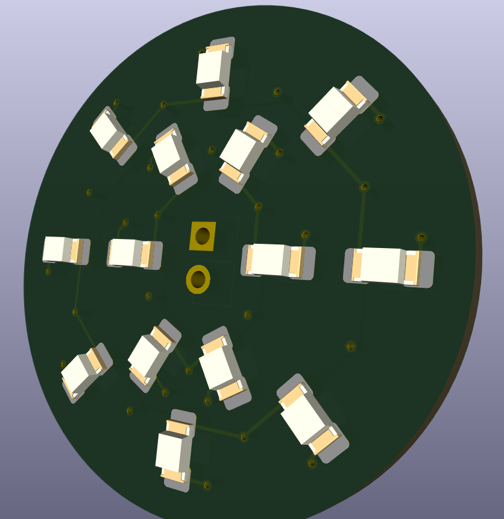
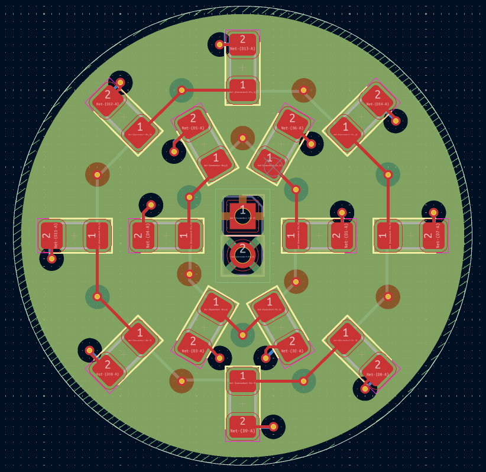
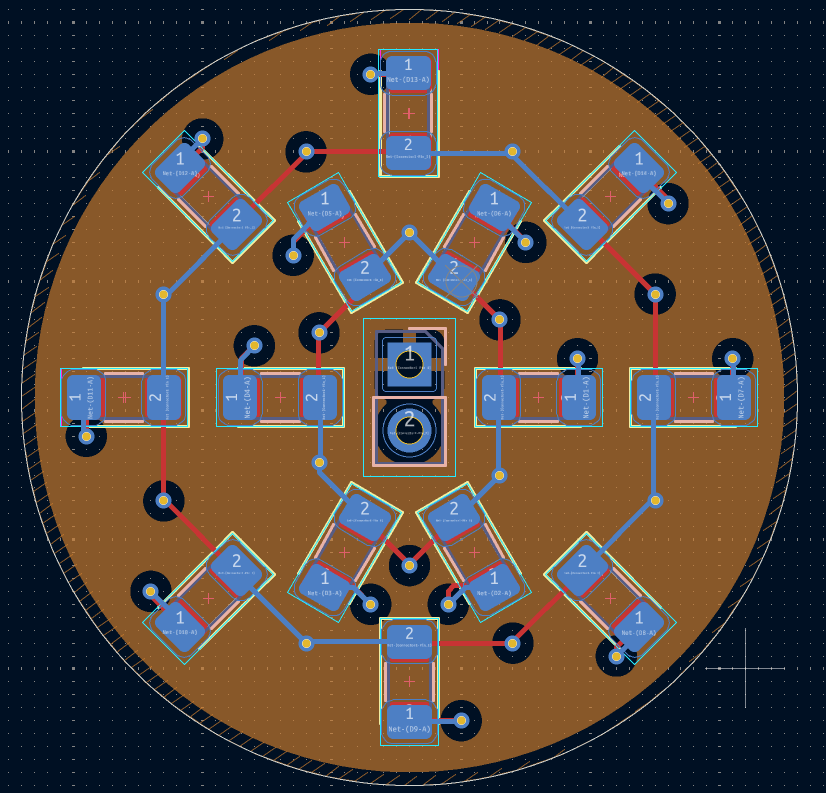

# Circular LED PCB

Design and development of a four-layer circular PCB featuring a 14-LED array for illumination purposes, designed using **KiCad 9.0**.

## Project Overview

This project focuses on the design of a compact circular printed circuit board (PCB) with 14 LEDs arranged in two concentric rings.

The PCB uses a four-layer architecture to simplify power distribution and ground connections while keeping the individual LED circuits properly routed.

## Technical Specifications

- **EDA software:** KiCad 9.0
- **PCB type:** Four-layer PCB
- **LED configuration:** 14 LEDs arranged in two concentric rings
- **LED drivers:** Individual series resistor for each LED
- **Power distribution:** Dedicated internal copper layer
- **Ground distribution:** Dedicated internal copper layer

## PCB Layer Stack-up

| Layer | Function |
|---|---|
| F.Cu | LED components and signal routing |
| In1.Cu | Ground plane (GND) |
| In2.Cu | Power distribution plane (+V) |
| B.Cu | Current-limiting resistors and routing |

## Design Features

- Circular PCB geometry.
- Two concentric LED arrays.
- Individual current-limiting resistors for each LED.
- Dedicated internal copper planes for power and ground distribution.
- Through-hole vias connecting surface components to internal copper layers.

## Repository Structure

- `.kicad_pro` – KiCad project configuration.
- `.kicad_pcb` – PCB layout.
- `.kicad_sch` – Electrical schematic, if available.
- `README.md` – Project documentation.

## PCB Design

### 3D View

### Front View

### Back View

## Tools

- KiCad 9.0

## Project Status

PCB layout and routing completed. Final design validation pending.

